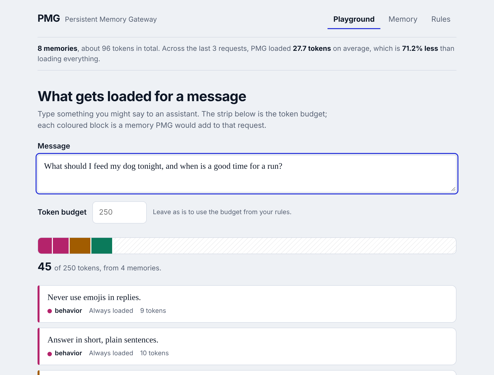
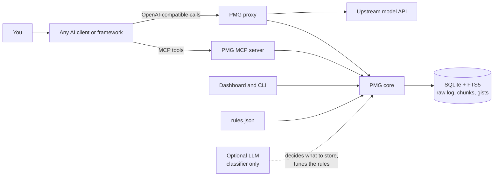
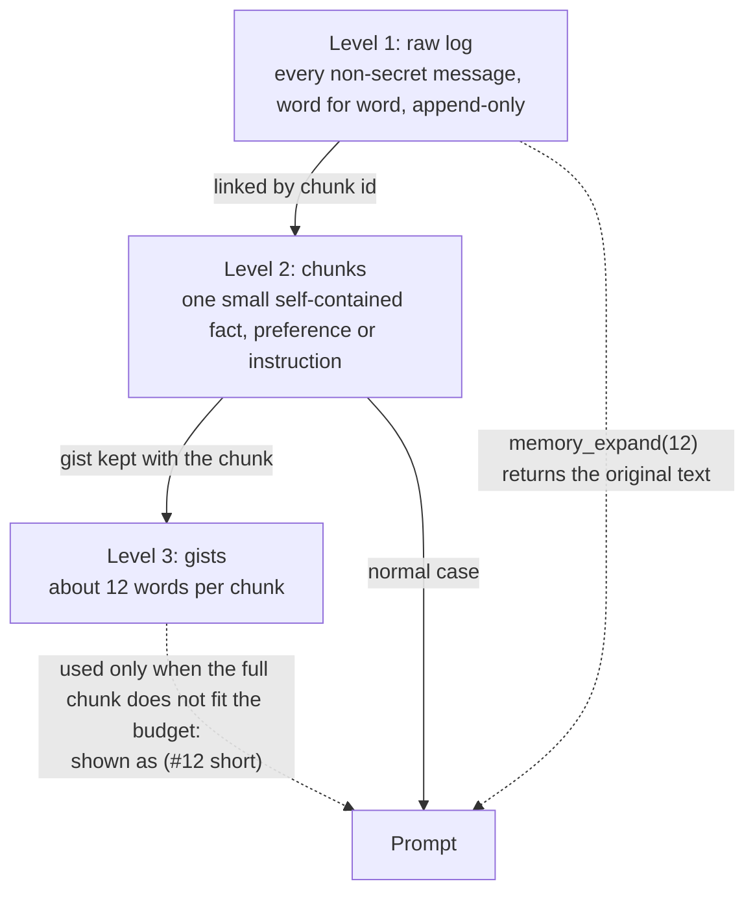
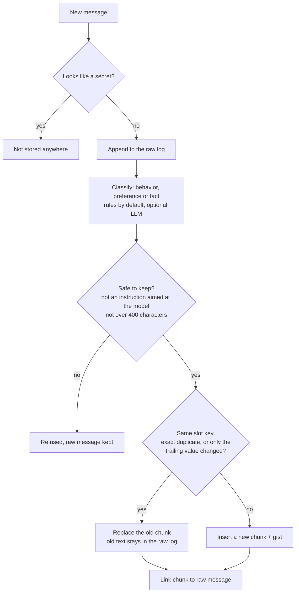
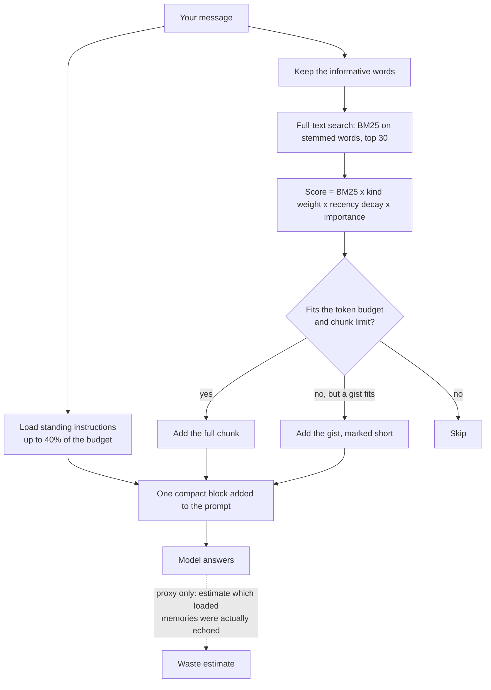

<div align="center">

# Persistent Memory Gateway

### One small memory layer for every AI model you use.

PMG remembers what matters about you, forgets what doesn't, and gives any model
only the few lines it needs, so conversations stay personal while token usage stays low.

[](https://github.com/sseraladen-svg/Persistent-Memory-Gateway-PMG/actions/workflows/ci.yml)
[](https://www.python.org)
[](https://modelcontextprotocol.io)
[](pyproject.toml)
[](LICENSE)

[Why PMG](#why-pmg) · [Quick start](#quick-start) · [Use it](#use-it-day-to-day) · [How it works](#how-it-works) · [Measured results](#measured-results) · [Strengths and limits](#advantages-limitations-and-how-to-overcome-them) · [Integrations](#integrations) · [Dashboard](#dashboard) · [Command line](#command-line) · [Design notes](#design-notes)

 

</div>

---

## Why PMG

Every AI chat starts from zero. The usual fix is to paste more history into the prompt, which costs tokens, slows
responses and buries the useful part under noise.

PMG takes the opposite approach. It is a **layer**, not another chatbot. It sits beside the models and tools you
already use and does four things:

| | |
|---|---|
| **Remember** | Keeps every message word for word, and turns durable facts, preferences and instructions into tiny chunks. |
| **Select** | For each message, loads only the chunks that match it, inside a hard token budget. |
| **Stay current** | A changed fact replaces the old one instead of stacking next to it. |
| **Protect** | Refuses secrets and text that tries to give the model instructions. |

The result is memory that follows you across models and sessions with a small, predictable footprint, and a
dashboard that shows what it loads and what it saves.

## Quick start

```bash
pip install git+https://github.com/sseraladen-svg/Persistent-Memory-Gateway-PMG
pip install mcp          # only needed to use PMG as an MCP server (Claude Desktop, Claude Code, Cursor)

pmg --version
pmg add remember that my dog is named Biscuit
pmg search what should my dog eat
pmg dashboard
```

PMG itself has no runtime dependencies. Works on Windows, macOS and Linux with Python 3.10 or newer. For development,
clone the repository and run `pip install -e ".[mcp]"` instead.

## Use it day to day

Pick the way that matches your AI tool. Both read and write the same local memory.

### A. Claude Desktop, Claude Code or Cursor (MCP)

1. Install as above, including `pip install mcp`.
2. Find where `pmg` was installed: `where pmg` on Windows, `which pmg` on macOS and Linux.
3. Add PMG to the client.
   - **Claude Code:** `claude mcp add pmg -- pmg mcp`
   - **Claude Desktop:** open Settings, then Developer, then Edit Config, and add this to `claude_desktop_config.json`
     (on Windows it is in `%APPDATA%\Claude`). If `pmg` is not on the client's PATH, use the full path from step 2, and
     double every backslash in JSON, for example `"C:\\Users\\you\\AppData\\Local\\Programs\\Python\\Python311\\Scripts\\pmg.exe"`.
     ```json
     { "mcpServers": { "pmg": { "command": "pmg", "args": ["mcp"] } } }
     ```
4. Restart the client. The `pmg` tools should appear in its tool list. Approve them when asked; "always allow" saves
   repeated prompts.
5. Try it. In one chat say: *"Remember that my audit deadline is March 3."* Open a **new** chat and ask: *"When is my
   audit deadline?"*
6. Check what was stored with `pmg list`, or open `pmg dashboard`.

How reliably the model calls the memory tools on its own depends on the model and the client. If it does not, say
"check your memory" or "remember this" and it will.

### B. Any tool with a configurable OpenAI-compatible base URL (proxy)

```bash
pmg proxy --upstream https://openrouter.ai/api/v1 --port 8766
```

Set your tool's base URL to `http://127.0.0.1:8766/v1` and keep your normal API key. PMG adds the relevant memory to
every request and stores what you say. Web apps such as ChatGPT in a browser cannot reach a program on your computer, so
this route is for local tools, frameworks and routers.

### Looking after your memory

| Task | How |
|---|---|
| See, search, edit and delete memories | `pmg dashboard` |
| Delete one memory (and its raw messages) | `pmg forget <id>` |
| Change the budget or rules | edit `~/.pmg/rules.json`, or use the dashboard Rules tab |
| Where is my data | `~/.pmg` (on Windows `C:\Users\<you>\.pmg`); set `PMG_DATA` to move it |
| Start over | close PMG, then delete that folder |
| Update PMG | run the `pip install --upgrade --force-reinstall git+...` command again |

## How it works

### 1. The big picture



The model you talk to never sees your whole history. PMG hands it a few lines. An LLM, if you configure one, is used
only to classify what to store and to suggest rule settings. It never chats through PMG.

### 2. Three levels of storage (nothing is lost)



Compact text is what gets loaded; the original is always underneath. Forgetting a chunk also deletes its raw
messages, so deletion is real.

### 3. What happens when you save something



### 4. What happens when you ask something



The budget (default 400 tokens) and chunk limit (default 6) cap every request, so what is added does not grow with how
much you have stored. A longer walkthrough, with the file that does each step, is in
[docs/HOW_IT_WORKS.md](docs/HOW_IT_WORKS.md).

## Measured results

These come from real datasets on a real machine, using keyword search. They are our own runs, not published scores,
and are not comparable with other systems' numbers. Every experiment's rule was written before it was run; see the
[experiment log](CLAUDE.md).

| | LoCoMo (1,981 questions) | LongMemEval (500 questions) |
|---|---|---|
| Full history per question | 20,555 tokens | 124,178 tokens |
| PMG product setting loads | 218 tokens (1.1%) | 375 tokens (0.3%) |
| Share of needed messages found | 56% | 68% |
| Lookup time | about 8 ms | about 14 ms |

What we confirmed:

- **Large token reduction.** PMG sends 0.2% to 5% of the history.
- **Fast.** Lookups take 7 to 14 ms. At 100,000 stored chunks the median is about 14 ms.
- **Replacing outdated notes works for simple values.** 95 of 100 date or number updates replaced the old note, with no
  wrong replacements (synthetic test).

What we tested and did not adopt:

| Idea | Result |
|---|---|
| Topology-based routing, fingerprint search (SimHash) | Failed. No gain over a simple score cutoff or exact search. |
| Embeddings (one small model) and hybrid keyword + embedding search | Failed on LoCoMo. Worse than keyword search at the same tokens. |
| Relative score cutoff | Mixed. About equal on LoCoMo, 15% to 23% fewer tokens on LongMemEval. Not proven. |
| Loading the turns next to a match | Passed on LoCoMo (34% to 44% fewer tokens), failed on LongMemEval. Kept as an opt-in setting. |
| Loading nothing for vague questions with a word-count rule | Failed. |

What is **not** proven yet:

- That a real model answers better with this memory. The answer test (`pmg bench-llm`) is built; it has not produced a
  usable result yet.
- Finding needed messages is still only 56% to 68% on these datasets.
- PMG does not know when nothing fits: for questions with no answer it still loads a few hundred tokens.
- Retrieval time still grows with store size, more slowly than before.

## Advantages, limitations and how to overcome them

### Metrics at a glance

All measured by us, on real data unless marked otherwise. Keyword search, product setting.

| Metric | Result | Data |
|---|---|---|
| Memory sent per question | 218 tokens (LoCoMo), 375 tokens (LongMemEval) | real |
| Share of full history sent | 1.1% and 0.3% (full history is 20,555 and 124,178 tokens) | real |
| Share of needed messages found | 56% and 68% | real |
| Lookup time | about 8 ms and 14 ms | real |
| Lookup time at 100,000 stored chunks | median 14 ms (was 60 ms before the speed fixes) | synthetic store |
| Outdated simple facts replaced | 95 of 100, with 0 wrong replacements | synthetic |
| Tests | 119 passing (core, safety, concurrency, proxy, MCP, benchmarks) | n/a |

For comparison on LoCoMo, a plain top-k keyword search needs about 183 tokens for 54% recall, 359 tokens for 62% and
706 tokens for 68%. PMG's product setting sits on that same curve: its gain is the token reduction, not better matching.

### Advantages

- **Large, predictable token savings.** 0.2% to 5% of the history, with a hard cap per request.
- **Lossless.** The raw log keeps every message, so shrinking never loses a detail you can later ask for.
- **Fast and light.** One SQLite file, no services, no runtime dependencies, single-digit to low double-digit milliseconds.
- **Model-independent.** The same memory serves Claude, ChatGPT and routers through MCP or an OpenAI-compatible proxy.
- **Stays current.** A changed value replaces the old one instead of leaving two contradicting notes.
- **Private and controllable.** Local storage, editable rules and chunks, real deletion (raw messages go too).
- **Safer than a plain notes file.** Secrets and instruction-style text are refused, and stored text is shown as data.
- **Measured, not claimed.** Each idea was tested against a baseline with the rule written first, and failures are kept
  in the record.

### Limitations and the planned ways to overcome them

The "how to overcome" column lists ideas, not results. None has passed its test yet. Each would be a new experiment
with its rule written before it runs.

| Limitation (measured) | Why it happens | How we plan to overcome it |
|---|---|---|
| **Finds only 56% to 68% of needed messages.** Even loading 700 tokens finds about 68% on LoCoMo. | Many needed messages are short replies ("Yeah, that was great!") that share few words with the question. | Write each chunk so it stands on its own when it is saved (a cheap model rewrites it with who, what and when). Try a stronger embedding model and a re-ranking step; our one small model did worse than keywords. Use the opt-in neighbour setting on chatty data. |
| **Cannot tell when nothing fits.** Questions with no answer still load about 400 tokens. | Keyword matching always returns something, and our word-count rule for abstaining failed. | Calibrate an absolute score cutoff on real data instead of word counts. Let the model decide when to call `memory_retrieve` (it already can over MCP). Try a cheap yes/no gate. |
| **Lookup time still grows with store size.** About 14 ms at 100,000 chunks, 4.4x slower than at 10,000. | The full-text query scans long lists for common words. | Select only the most informative query terms. Test an index that scans a small share of the vectors; our first index check read 7% to 12% of the data for 90% to 96% overlap, which is not yet enough, and was run on a small set. |
| **Misses paraphrases.** "Canine" will not find "dog". | Keyword search matches words, not meaning. | Store a few synonyms or aliases with each chunk when it is saved. Try other embedding models and hybrid search on paraphrase-heavy data. |
| **Replaces outdated notes only for simple values** such as dates and numbers. | The rule is a cheap text comparison. | Let an optional model assign a slot key to each fact when it is saved, one small call per save. Test it on messy real phrasing. |
| **Not proven that a real model answers better with this memory.** | The answer test is built but has not produced a usable result (free-model limits). | Run `pmg bench-llm` with a capable model, 30 or more questions, and report all five memory settings side by side. |
| **The waste estimate is unvalidated.** | It guesses use from repeated words in the reply. | Compare it with the answer test's ground truth, which `pmg bench-llm` already prints. |
| **Token counts are estimates** (about four characters per token). | No tokenizer is bundled, to keep zero dependencies. | Optional exact counting when a tokenizer is installed. |
| **A poisoned model could store a plausible false fact.** | The safety checks catch instructions and secrets, not wrong facts. | Show where each memory came from, and flag new memories written by a model for your review in the dashboard. |
| **Anything PMG adds goes to your model provider.** | That is how prompts work. | Use a local model for sensitive material. |

The results table above and the [experiment log](CLAUDE.md) say what has been tried and what has failed.

## Integrations

Full steps are in the [integration guide](docs/INTEGRATION.md).

**MCP server** for Claude Desktop, Claude Code, Cursor and other MCP clients:

```bash
claude mcp add pmg -- pmg mcp
```

| Tool | Purpose |
|---|---|
| `memory_retrieve` | Return the relevant chunks for a message, within a token budget. |
| `memory_remember` | Store a durable fact, preference or instruction. |
| `memory_expand` | Return a chunk with the original raw messages behind it. |
| `memory_forget` | Delete one chunk and its raw messages. |
| `memory_list` | Review what is stored. |
| `memory_tune` | Ask the optional LLM to propose better numeric settings. Applied only on request. |

**OpenAI-compatible proxy** for routers and frameworks with a configurable base URL:

```bash
pmg proxy --upstream https://openrouter.ai/api/v1 --port 8766
```

Point your client at `http://127.0.0.1:8766/v1` and keep using your normal API key. Each request gets one compact
system message of relevant memory, and your message is classified and stored afterwards. Streaming and upstream
errors pass through.

## Dashboard

```bash
pmg dashboard
```

- **Playground.** Type a message and watch a strip fill with the memories PMG would add, measured against your token
  budget. Nothing is sent anywhere.
- **Memory.** Search, add and delete what is stored. Deleting asks first.
- **Rules.** Edit the budget and limits, review each kind, or edit the whole rules file as JSON with validation.

The usage line shows loaded tokens against everything stored, the number of raw messages kept, median lookup time and
(through the proxy) an estimate of how much loaded memory the reply actually used. The dashboard accepts only local
connections and requires a custom header on every change.

## Command line

| Command | Purpose |
|---|---|
| `pmg add <text>` | Remember something. Add `--kind fact` to store it exactly as written. |
| `pmg search <message>` | Show what would be loaded for a message. |
| `pmg list` | List stored memories. |
| `pmg forget <id>` | Delete one memory and its raw messages. |
| `pmg stats` | Show size and token savings. |
| `pmg rules` | Validate the rules file and show where it lives. |
| `pmg bench <file>` | Measure tokens loaded against recall on LoCoMo, LongMemEval or your own JSON. |
| `pmg bench-llm <file>` | Ask a real model the questions under each memory policy (uses API calls). |
| `pmg validate <file>` | Run the real-data checks and write one report, `pmg-validation.md`. |
| `pmg dashboard` / `pmg proxy` / `pmg mcp` | Run the dashboard, proxy or MCP server. |

Benchmark steps are in [docs/BENCHMARKS.md](docs/BENCHMARKS.md). Large dataset files are read one item at a time.

## Configuration

Behavior lives in [`rules.json`](pmg/rules.default.json), copied to `~/.pmg/rules.json` on first use. Set `PMG_DATA`
to keep your data somewhere else.

| Setting | Meaning |
|---|---|
| `budget_tokens` | Most memory loaded for one request (default 400). |
| `always_load_share` | Part of the budget kept for standing instructions (default 0.4). |
| `max_chunks` | Most memories loaded for one request (default 6). |
| `kinds.*` | Trigger phrases, ranking weight, always-load flag and recency half-life per kind. |
| `never_store_patterns` | Regular expressions for content that must never be saved. |

Settings on the `Memory` object, for developers:

| Setting | Default | Meaning |
|---|---|---|
| `supersede` | on | Replace a note when a new one changes only its trailing value. |
| `neighbours` | 0 (off) | Also load the raw message before and after the top N matches. Helped on LoCoMo, not on LongMemEval. |
| `common_df` | 0 (off) | Drop very common query words. Faster at 100,000 chunks, not adopted by default. |
| `evidence_rule` | off | Load nothing unless the matches share informative words. Did not pass its test. |

To classify with a model, set `PMG_LLM_BASE_URL` and `PMG_LLM_MODEL` (and `PMG_LLM_KEY` if needed) to any
OpenAI-compatible endpoint, such as a local Ollama model.

## Design notes

- **No services to run.** One SQLite file with the built-in FTS5 index. No Redis, no vector database.
- **Bounded by construction.** The token budget and chunk limit cap what is added to each request.
- **Lossless.** Every non-secret message stays in the raw log; chunks and gists are views on top of it.
- **Safe by default.** Secrets and instruction-style text are refused at every entry point, memories are shown one
  line each so they cannot forge a section, model output is validated, and the dashboard only talks to your machine.
  One risk remains: a poisoned model could store a harmless-looking but false fact. The dashboard lets you review it.
- **Concurrent.** Writers take the database lock first, and the rules file is written atomically.
- **Honest limits.** Search is keyword-based with stemming, so "canine" will not find a memory about a "dog". The one
  embedding model we tried did not beat it. Token counts are estimates (about four characters per token).
- **Privacy.** Memory is a local file, but anything PMG adds to a request goes to whichever model provider you use.

## Project layout

```
pmg/
  core:      store.py  classify.py  rules.py  config.py  textutil.py  ledger.py  waste.py  llm.py
  adapters:  mcp_server.py  proxy.py  dashboard.py  cli.py
  measuring: bench.py  bench_llm.py  embed.py  ann.py
  assets:    rules.default.json  web/index.html
tests/        119 tests: core, safety, concurrency, speed path, proxy, MCP, benchmarks
experiments/  one folder per experiment: protocol written first, then results
docs/         HOW_IT_WORKS.md, INTEGRATION.md, BENCHMARKS.md, screenshots
legacy/       the original chat client this project grew from
```

```bash
python -m unittest discover -s tests -v     # run the tests
```

## Contributing

Issues and pull requests are welcome. Read [CONTRIBUTING.md](CONTRIBUTING.md) first: new ideas are accepted only
after a test written in advance, and failed results are recorded, not hidden. See the [changelog](CHANGELOG.md) for
what has changed.

## License

[MIT](LICENSE)

<div align="center">

Built by [@sseraladen-svg](https://github.com/sseraladen-svg)

</div>
