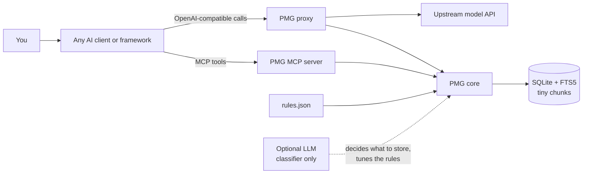

<div align="center">

# Persistent Memory Gateway (PMG)

### One small memory layer for every AI model you use.

PMG remembers what matters about you, forgets what doesn't, and hands any model
only the few lines it needs, so conversations stay personal while token usage stays low.

[](https://www.python.org)
[](https://modelcontextprotocol.io)
[](https://www.sqlite.org/fts5.html)
[](test_core.py)

[Why PMG](#why-pmg) · [How it works](#how-it-works) · [Quick start](#quick-start) · [Integrations](#integrations) · [Configuration](#configuration) · [Design notes](#design-notes) · [Project layout](#project-layout)

</div>

---

## Why PMG

Every AI chat starts from zero. The usual fix is to paste more history into the prompt, which costs
tokens, slows responses, and buries the useful part under noise.

PMG takes the opposite approach. It is a **layer**, not another chatbot. It sits beside the models and
tools you already use (Claude, ChatGPT-style clients, routers such as OpenRouter or OmniRoute) and does
three things:

| | |
|---|---|
| **Remember** | Turns durable facts, preferences and standing instructions into tiny, self-contained chunks. |
| **Select** | For each new message, loads only the chunks that match it, inside a hard token budget. |
| **Protect** | Refuses to store secrets such as API keys, passwords and card numbers. |

The result is memory that follows you across models and sessions, with a predictable, small footprint.

## How it works



**Storing.** A message is classified as a `behavior` (standing instruction), `preference` or `fact`.
The classifier is rule-based by default, driven by keyword triggers in `rules.json`. If you configure a
model, it can classify more intelligently, but its answer is validated (allowed kinds, length, secret
patterns) and the layer falls back to the rules on any problem. The model never chats with you through PMG.

**Retrieving.** Behavior rules load every time, up to a share of the budget. Everything else is ranked
with BM25 full-text search, then weighted by kind, importance and recency decay, and added until the token
budget or chunk limit is reached. Chunks that keep being useful are counted, so you can see what earns its place.

**Updating.** A fact can own a named slot (for example `user.city`). Saving a new value replaces the old one
instead of piling up contradictions. Exact duplicates are merged.

## Quick start

```bash
git clone https://github.com/sseraladen-svg/persistent-memory-gateway-pmg
cd persistent-memory-gateway-pmg
pip install -r requirements-layer.txt
python test_core.py
```

Run the MCP server for a local client:

```bash
python mcp_server.py
```

## Integrations

PMG offers two ways in. Full steps are in [INTEGRATE.md](INTEGRATE.md).

### 1. MCP server: Claude Desktop, Claude Code, Cursor and other MCP clients

```json
{ "mcpServers": { "pmg": { "command": "python", "args": ["/absolute/path/to/mcp_server.py"] } } }
```

| Tool | Purpose |
|---|---|
| `memory_retrieve` | Return the relevant chunks for a message, within a token budget. |
| `memory_remember` | Store a durable fact, preference or instruction. |
| `memory_forget` | Delete one chunk by id. |
| `memory_list` | Review what is stored. |
| `memory_tune` | Ask the optional LLM to propose better numeric settings; applied only on request. |

For clients that need a URL, `python mcp_server.py --http --port 8765` serves streamable HTTP. Put
authentication in front of it before exposing it beyond your own machine.

### 2. OpenAI-compatible proxy: routers and frameworks

```bash
export PMG_UPSTREAM_URL=https://openrouter.ai/api/v1
uvicorn proxy:app --port 8766
```

Point your client's base URL at `http://127.0.0.1:8766/v1` and keep using your normal API key. Each request
gets one compact system message of relevant memory; the user's message is classified and stored afterwards.
The proxy is new and has been syntax-checked but not yet exercised against a live router, so treat it as experimental.

## Configuration

All behavior lives in [`rules.json`](rules.json):

| Setting | Meaning |
|---|---|
| `budget_tokens` | Hard cap on memory injected per request (default 400). |
| `always_load_share` | Portion of the budget reserved for always-on behavior rules. |
| `max_chunks` | Upper limit on chunks per request. |
| `kinds.*` | Trigger phrases, ranking weight, always-load flag and recency half-life per kind. |
| `never_store_patterns` | Regular expressions for content that must never be saved. |

Optional offline classifier, using any OpenAI-compatible endpoint such as a local Ollama model:

```bash
export PMG_LLM_BASE_URL=http://localhost:11434/v1
export PMG_LLM_MODEL=llama3.1:8b
```

## Design notes

- **No services to run.** SQLite with the built-in FTS5 index is the only store; there is no Redis or vector database to operate.
- **Bounded by construction.** The token budget and chunk limit cap what is injected per request, so cost does not grow with how much you have stored.
- **Safe by default.** Secret patterns are blocked before storage; LLM output is validated and never trusted blindly; tuning suggestions are clamped to safe ranges.
- **Known limits.** Retrieval is keyword-based, so a query for "canine" will not find a chunk about "dog". Semantic matching with a small embedding model is a natural next step.

## Project layout

```
pmg_core.py            Memory store, classifier, retrieval and tuning (the layer itself)
mcp_server.py          MCP server exposing the layer as tools
proxy.py               OpenAI-compatible proxy for routers and frameworks
rules.json             Editable rules: budget, kinds, weights, never-store patterns
test_core.py           Unit tests for the core
INTEGRATE.md           Step-by-step connection guide
requirements-layer.txt Dependencies for the layer

server.py, memory.py,  The original chat client (FastAPI + web UI) that this project
model_providers.py,    grew from, kept as a reference implementation
index.html, start.bat
```

## The original chat client

The repository began as a multi-provider chat app (Ollama, OpenAI, Anthropic, HuggingFace and custom
endpoints) with a web interface, voice input and a keyword-triggered memory. It still works and is the
prototype the layer was distilled from. See `config.example.json` and `start.bat` to run it. Note that it
stores chat messages locally in SQLite.

## Contributing

Issues and pull requests are welcome. Run `python test_core.py` before submitting.

---

<div align="center">

Built by [@sseraladen-svg](https://github.com/sseraladen-svg)

</div>
