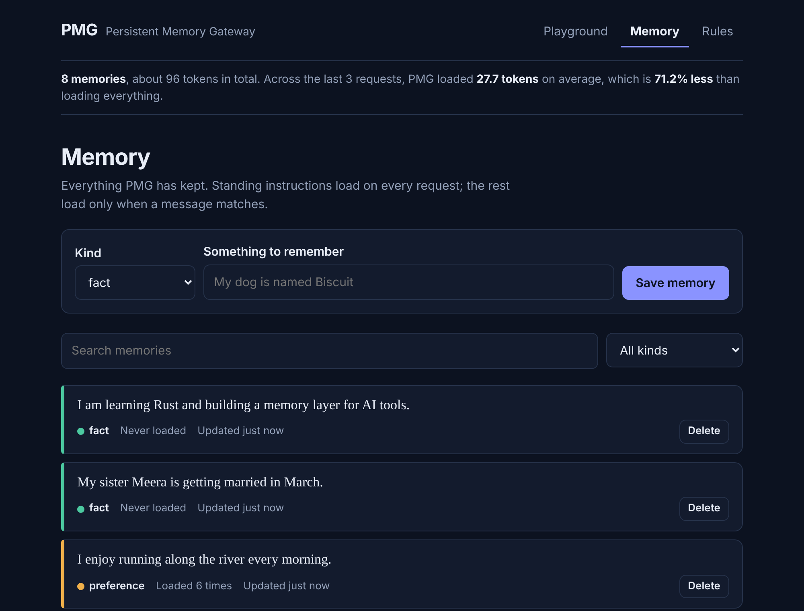
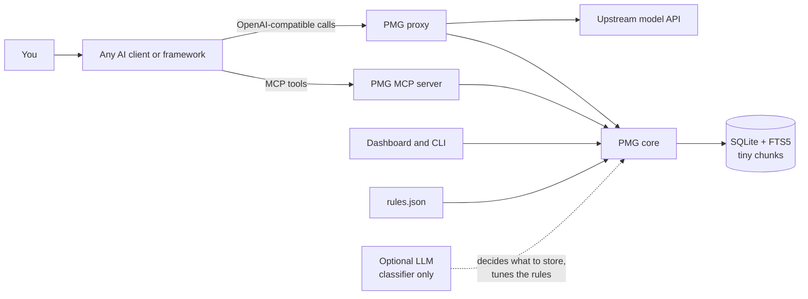

<div align="center">

# Persistent Memory Gateway

### One small memory layer for every AI model you use.

PMG remembers what matters about you, forgets what doesn't, and gives any model
only the few lines it needs, so conversations stay personal while token usage stays low.

[](https://github.com/sseraladen-svg/Persistent-Memory-Gateway-PMG/actions/workflows/ci.yml)
[](https://www.python.org)
[](https://modelcontextprotocol.io)
[](pyproject.toml)
[](LICENSE)

[Why PMG](#why-pmg) · [Quick start](#quick-start) · [How it works](#how-it-works) · [Integrations](#integrations) · [Dashboard](#dashboard) · [Command line](#command-line) · [Design notes](#design-notes)

 

</div>

---

## Why PMG

Every AI chat starts from zero. The usual fix is to paste more history into the prompt, which costs tokens, slows
responses and buries the useful part under noise.

PMG takes the opposite approach. It is a **layer**, not another chatbot. It sits beside the models and tools you
already use and does three things:

| | |
|---|---|
| **Remember** | Turns durable facts, preferences and standing instructions into tiny, self-contained chunks. |
| **Select** | For each message, loads only the chunks that match it, inside a hard token budget. |
| **Protect** | Refuses to store secrets such as API keys, passwords and card numbers. |

The result is memory that follows you across models and sessions with a small, predictable footprint, and a
dashboard that shows you exactly what it would load and what it saves.

## Quick start

```bash
git clone https://github.com/sseraladen-svg/Persistent-Memory-Gateway-PMG
cd Persistent-Memory-Gateway-PMG
pip install -e ".[mcp]"

pmg add remember that my dog is named Biscuit
pmg search what should my dog eat
pmg dashboard
```

PMG has no runtime dependencies. The `mcp` extra is only needed for the MCP server.

## How it works



**Storing.** A message is classified as a `behavior` (standing instruction), `preference` or `fact`. The classifier is
rule-based by default, driven by trigger phrases in `rules.json`. If you configure a model it can classify with more
nuance, but its answer is validated (allowed kinds, length, secret patterns) and the rules take over on any problem.
The model never chats with you through PMG.

**Retrieving.** Standing instructions load every time, up to a share of the budget. Everything else is ranked with
BM25 full-text search on stemmed words (so "run" finds "running"), weighted by kind, importance and recency decay, and
added until the token budget or chunk limit is reached.

**Updating.** A fact can own a named slot such as `user.city`. Saving a new value replaces the old one instead of
leaving two contradicting memories. Exact duplicates are merged.

## Integrations

Full steps are in the [integration guide](docs/INTEGRATION.md).

**MCP server** for Claude Desktop, Claude Code, Cursor and other MCP clients:

```bash
claude mcp add pmg -- pmg mcp
```

| Tool | Purpose |
|---|---|
| `memory_retrieve` | Return the relevant chunks for a message, within a token budget. |
| `memory_remember` | Store a durable fact, preference or instruction. |
| `memory_forget` | Delete one chunk by id. |
| `memory_list` | Review what is stored. |
| `memory_tune` | Ask the optional LLM to propose better numeric settings. Applied only on request. |

**OpenAI-compatible proxy** for routers and frameworks with a configurable base URL:

```bash
pmg proxy --upstream https://openrouter.ai/api/v1 --port 8766
```

Point your client at `http://127.0.0.1:8766/v1` and keep using your normal API key. Each request gets one compact
system message of relevant memory, and your message is classified and stored afterwards. Streaming and upstream
errors pass through.

## Dashboard

```bash
pmg dashboard
```

- **Playground.** Type a message and watch a strip fill with the memories PMG would add, measured against your token
  budget. Nothing is sent anywhere.
- **Memory.** Search, add and delete what is stored. Deleting asks first.
- **Rules.** Edit the budget and limits, review each kind, or edit the whole rules file as JSON with validation.

The usage line at the top shows the real saving: how many tokens were loaded on average compared with loading
everything. The dashboard accepts only local connections and requires a custom header on every change.

## Command line

| Command | Purpose |
|---|---|
| `pmg add <text>` | Remember something. Add `--kind fact` to store it exactly as written. |
| `pmg search <message>` | Show what would be loaded for a message. |
| `pmg list` | List stored memories. |
| `pmg forget <id>` | Delete one memory. |
| `pmg stats` | Show size and token savings. |
| `pmg rules` | Validate the rules file and show where it lives. |
| `pmg dashboard` / `pmg proxy` / `pmg mcp` | Run the dashboard, proxy or MCP server. |

## Configuration

Behavior lives in [`rules.json`](pmg/rules.default.json), copied to `~/.pmg/rules.json` on first use. Set `PMG_DATA`
to keep your data somewhere else.

| Setting | Meaning |
|---|---|
| `budget_tokens` | Most memory loaded for one request (default 400). |
| `always_load_share` | Part of the budget kept for standing instructions. |
| `max_chunks` | Most memories loaded for one request. |
| `kinds.*` | Trigger phrases, ranking weight, always-load flag and recency half-life per kind. |
| `never_store_patterns` | Regular expressions for content that must never be saved. |

To classify with a model, set `PMG_LLM_BASE_URL` and `PMG_LLM_MODEL` to any OpenAI-compatible endpoint, such as a
local Ollama model.

## Design notes

- **No services to run.** One SQLite file with the built-in FTS5 index. No Redis, no vector database.
- **Bounded by construction.** The token budget and chunk limit cap what is added to each request, so cost does not
  grow with how much you have stored.
- **Safe by default.** Secret patterns are blocked before storage, model output is validated, tuning suggestions are
  clamped to safe ranges, and the dashboard only talks to your own machine.
- **Honest limits.** Search is keyword-based with stemming, so "canine" will not find a memory about a "dog".
  Semantic matching with a small embedding model is a natural next step. The token counts are estimates (about four
  characters per token), which is accurate enough for budgeting but not exact.
- **Privacy.** Memory is a local file, but anything PMG adds to a request goes to whichever model provider you use.

## Project layout

```
pmg/
  core:      store.py  classify.py  rules.py  config.py  textutil.py  llm.py
  adapters:  mcp_server.py  proxy.py  dashboard.py  cli.py
  assets:    rules.default.json  web/index.html
tests/       32 tests covering the core, proxy, dashboard security, CLI and MCP tools
docs/        integration guide and screenshots
legacy/      the original chat client this project grew from
```

```bash
python -m unittest discover -s tests -v     # run the tests
```

## Contributing

Issues and pull requests are welcome. Please run the tests before submitting. See the [changelog](CHANGELOG.md) for
what has changed.

## License

[MIT](LICENSE)

<div align="center">

Built by [@sseraladen-svg](https://github.com/sseraladen-svg)

</div>
